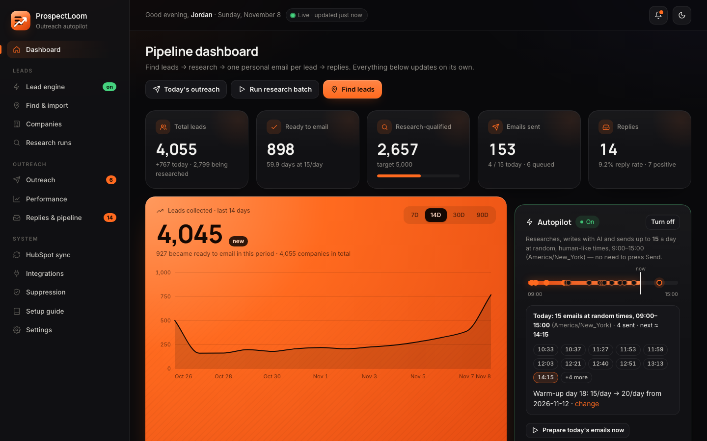
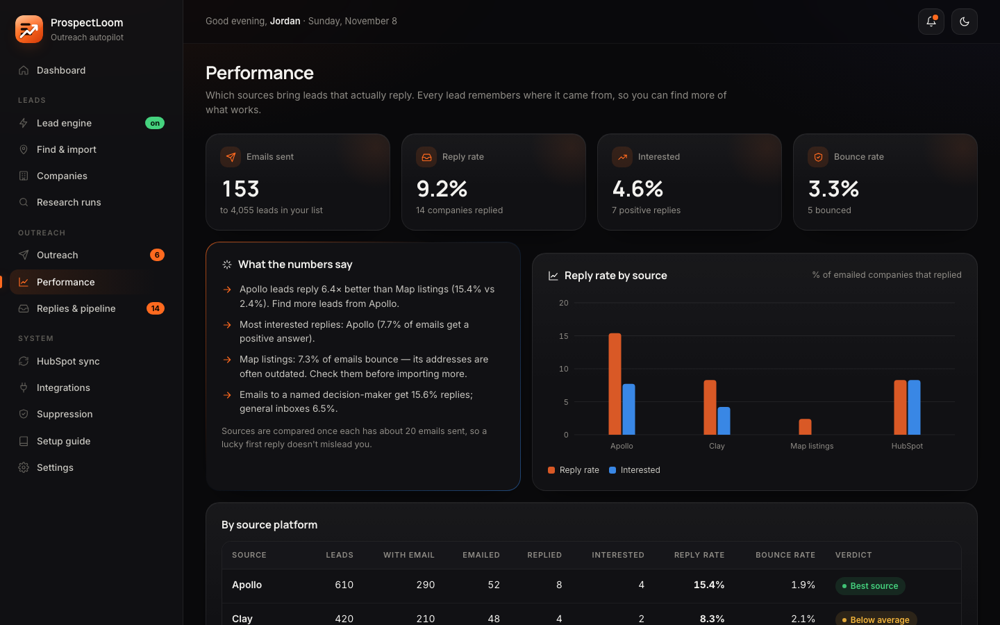
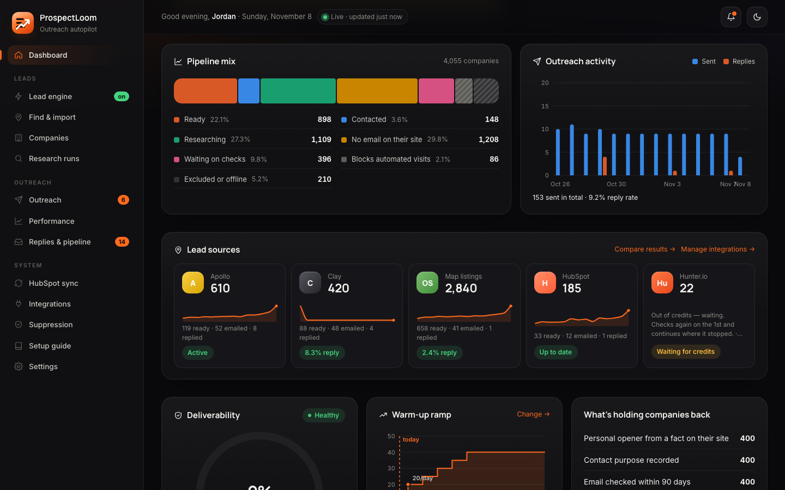
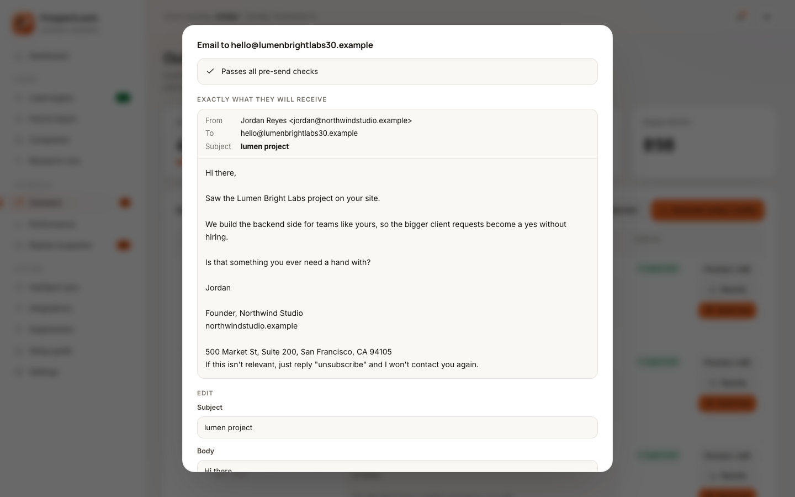
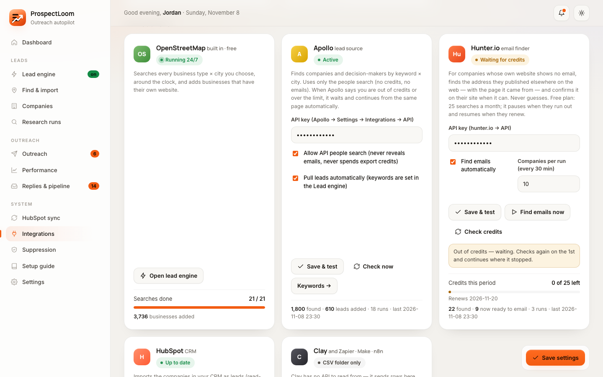
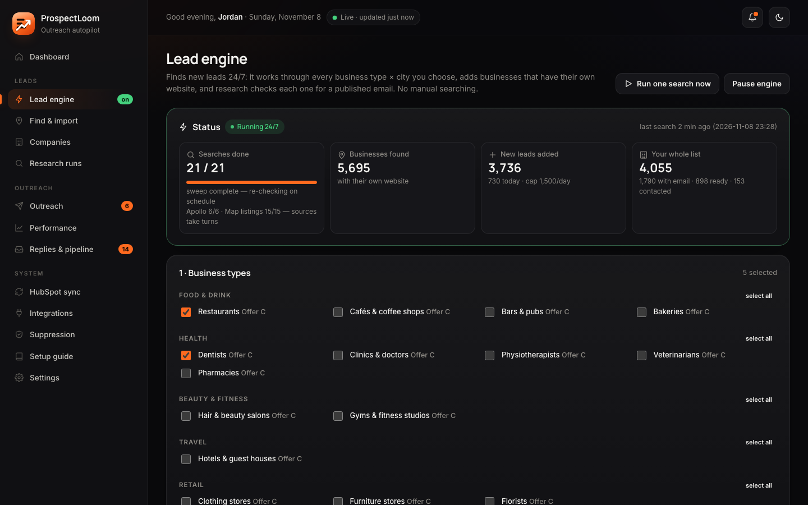
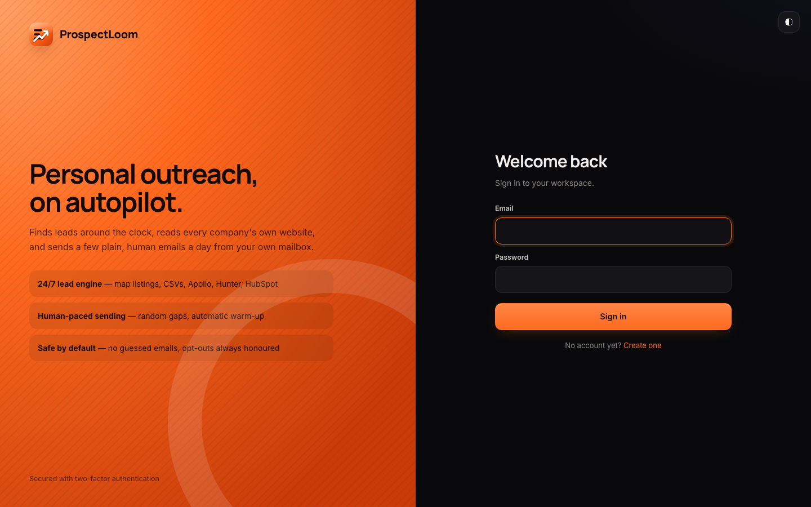
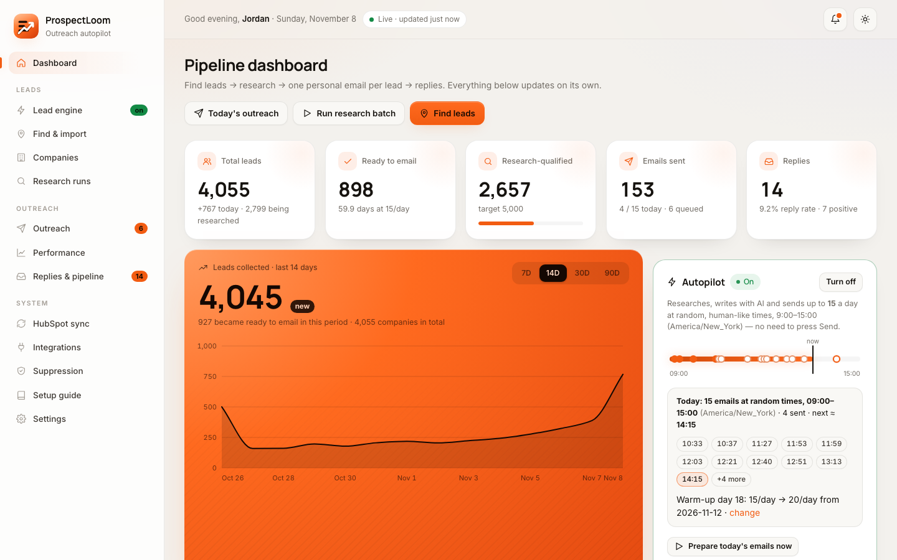

# ProspectLoom

<p align="center"></p>

**Personal outreach on autopilot.** ProspectLoom finds leads around the clock and researches every company from its own website. It then sends a few plain, human-sounding emails each day from your own mailbox, and shows which lead sources actually bring replies.

find leads → research their website → one personal email per lead → send at random, human-like times with a warm-up → track replies per source



<sub>Screenshots use the built-in demo workspace (`npm run demo`). Every company in them is fictional.</sub>

## What you get

- **Leads 24/7, from many sources:**
  - a built-in OpenStreetMap lead engine (business type × city);
  - Apollo, HubSpot and Clay, plus any CSV dropped into a watched folder;
  - Hunter.io, which fills in missing emails.
  - Paid sources pause when their credits run out and continue when they renew.
- **Research on every company:** its own website is read for what the company does, a published email and one real fact for the opener. Dead or bot-protected sites are recognised, and nothing is guessed.
- **Emails that read like a person wrote them:**
  - one per lead, written with Groq (free) from verified facts;
  - a quality check rejects flattery, sales jargon, copied pitch lines and invented numbers;
  - preview each email exactly as it arrives, edit it or rewrite it.
- **Careful sending:**
  - random send times across a 6-hour window, different every day;
  - an automatic warm-up (10/day for 14 days, then up to 40);
  - a bounce guard, and opt-outs that are always honoured.
- **Source performance:** every lead remembers where it came from, and the Performance page compares reply, interest and bounce rates per platform. You can see which source deserves more effort.
- **Accounts:** sign-in with two-factor authentication. Every account gets its own private workspace. Dark and light themes are included.

| | |
|---|---|
|  |  |
| **Performance:** reply, interest and bounce rates per source, with a verdict once each source has enough emails sent | **Dashboard:** pipeline mix, daily outreach activity, lead sources with trends, deliverability and the warm-up ramp |
|  |  |
| **Every email, exactly as it arrives:** subject, body and signature footer, with pre-send checks | **Integrations:** fill in a key, Save & test. Credit-aware sources show what's left and when they continue |
|  |  |
| **Lead engine:** business types × cities, searched around the clock; sources take turns | **Sign-in:** private workspaces with two-factor authentication |

<details><summary>Light theme</summary>



</details>

## Try it with demo data

```bash
npm install
npm run demo        # builds a fictional demo workspace and opens it on http://127.0.0.1:4320
```

## Run it

```bash
npm install
cp .env.example .env     # then put GROQ_API_KEY=... in .env (never in .env.example)
npm start                # http://127.0.0.1:4317
```

Requires Node 22.13+ (uses the built-in `node:sqlite`). Data lives in `data/pipeline.db`. To keep a Mac awake during the sending window, run `caffeinate -i npm start`.

## Setup (all free; the in-app **Setup guide** has the same steps)

1. **Settings → Sender & compliance**: name, sender email, postal address and an opt-out line.
2. **Settings → Integrations → Hostinger mailbox**: enter the mailbox email and its password (the webmail password, not your hPanel login). The servers are already filled in: SMTP `smtp.hostinger.com:465` (SSL/TLS, or 587 STARTTLS) and IMAP `imap.hostinger.com:993`. One login is used for both. Click *Save & test connection*, then *Send a test email to myself*. The first successful test reads your Sent folder, so nobody you already emailed gets a second intro.
   - If the mailbox fails (wrong password, network, Hostinger rate limit), the email stays approved, sending pauses for 30 minutes and the dashboard says why. The approved queue is never used up by failed attempts.
3. **AI writing**: get a free key at console.groq.com/keys and put it in `.env` as `GROQ_API_KEY`. Click *Test AI*. The default model is `openai/gpt-oss-120b`.
4. **Settings → Autopilot & schedule**:
   - Set the recipients' timezone and the starting daily limit (10). The warm-up raises it by itself (see below).
   - Turn autopilot on from the dashboard.

## How leads come in (hands-free)

- **Lead engine** (sidebar → Lead engine) runs 24/7:
  - It searches every business type × city you choose on OpenStreetMap. Presets cover the 50 or 100 largest US cities, plus UK, Canada, Australia, Germany and the UAE.
  - It adds every business that has its own website, and searches Apollo keywords × cities too if an Apollo key is enabled.
  - It runs one search at a time (default 20 per hour) with a daily cap, and re-checks each city every 30 days for new businesses.
- **Leads folder**: drop CSV files into `leads csv/` and new or changed files are imported every 10 minutes. Columns are detected automatically, including Clay research exports (decision-maker email, opener, evidence URL, lead score).
- **Find & import**: local-business search for one city, pasted websites, CSV files (several at once) and the Clay webhook.
- **Already contacted**: paste emails or domains you emailed with other tools. Your Hostinger Sent folder is read over IMAP. Either way, those people never get a second intro.
- **Background jobs**: searches, imports, research and autopilot run on the server. Their progress shows in the sidebar on every page, so leaving a page never loses work.

## Accounts, private workspaces & two-factor authentication

Every account has its **own private workspace**: its own leads, emails, settings, mailbox and keys, stored in a separate database file. One account can never see another's data.

- **Existing data:** the original database (`data/pipeline.db`) belongs to its owner email. That's `OWNER_EMAIL` in `.env`, or the sender email saved in it. Signing up with that email opens the existing data, but only after entering a 6-digit code emailed to that address, so nobody else can claim it by typing the address. If its mailbox isn't set up yet, the code is printed in the server log.
- **Everyone else:** any other email gets a new, empty workspace. Set `SIGNUPS=closed` to stop new sign-ups.
- **Your private keys:** keys in `.env` (Groq, HubSpot…) are used only by the server owner's workspace. Other accounts add their own in Integrations.
- **Security:** passwords are hashed with scrypt. Sessions last 30 days in an HttpOnly cookie, and only their hash is stored. After 5 wrong attempts, sign-in pauses for 15 minutes.
- **2FA:** Settings → Security → *Turn on two-factor authentication*. Scan the QR code with any authenticator app and save the 8 one-time recovery codes.
- **Public links:** unsubscribe links and the Clay webhook stay public. Each workspace has its own webhook secret.

## Deploying (always-on server)

The app needs a machine that runs 24/7: the scheduler sends emails, the lead engine searches, and the mailbox is read every 10 minutes. Shared web hosting can't run that. A small VPS can, for example Hostinger VPS (KVM 1) or Oracle Cloud's Always Free VM.

1. Ubuntu 24.04, Node 24, nginx as an HTTPS reverse proxy (Let's Encrypt), and the app as a systemd service (`npm start`).
2. DNS: an `A` record such as `app.yourdomain.com` pointing to the server's IP.
3. `.env` on the server: your keys plus `PUBLIC_BASE_URL=https://app.yourdomain.com`. Copy `data/` across to keep your leads and history.
4. Run **one** copy only. Stop the local one once the server is live, or both will send.

## Integrations (all optional)

Open **Integrations** in the sidebar: every tool is one card. Fill in the fields, click **Save & test**, done.

| Tool | What it adds | Credits |
|---|---|---|
| OpenStreetMap (built in) | Businesses with their own website, for every business type × city in the Lead engine | free |
| Apollo | Companies and decision-makers by keyword × city (people search only, never reveals emails) | waits and resumes on its own |
| Hunter.io | The published email for companies whose website shows none, with the page it came from (confirmed on their site when possible, never guessed) | free plan 25/month, waits for renewal |
| HubSpot | Imports your CRM companies as leads; optional status sync after approval | API limits respected |
| Clay / Zapier / Make / n8n | Rows posted to the webhook, or CSVs dropped into `leads csv` | managed by Clay |

**Credit-aware autopilot.** Each paid source pulls leads while it can. When the provider answers "out of credits", "rate limited" or "not in your plan", the source pauses. It waits until the renewal date when the provider gives one, and otherwise checks again daily. Then it continues from where it stopped: Apollo keeps its page per keyword × city, HubSpot its paging cursor, and Hunter never looks up the same company twice. Waiting sources appear on the dashboard and in Integrations. Changing a key re-checks right away.

**Look & feel.** The dark (matte) and light themes switch from the top bar and are remembered. Charts are plain SVG with hover tooltips. An open tab reloads itself when the app is updated.

## How emails are written

Each email is written for one company, from facts found on its own website: one specific thing they do, what you offer in one sentence, and one low-pressure question. The writer is told to sound like a person typing a quick note: 45–90 words, plain words, no flattery or sales jargon, no dashes, no copied pitch lines. Every AI draft goes through a quality check. Drafts that sound machine-written ("impressed by", "seamless", "explore how", a copied offer line, invented numbers, links…) get one rewrite with feedback, and otherwise fall back to your template. Optionally paste an email you wrote yourself in Settings → AI writing, and the AI matches its tone.

In Outreach you can open the full email exactly as it will arrive, edit it, or click **Rewrite**. Turn on **Let me approve each email** (Settings → Autopilot) if you want to read every email before it can go out.

## Research, in short

Every company's own website is read (up to 10 pages, robots.txt respected): what they do, a published email, an address and one real fact for the opener. Then the email's domain is checked for MX/SPF/DMARC, and the company is checked against duplicates, opt-outs and your Sent folder. Websites that no longer exist are excluded automatically. Sites behind bot protection (Cloudflare, SiteGround) are never bypassed: they're parked for 30 days and listed for you. Companies without a published email are re-checked every 14 days.

## Daily workflow

1. **Research** runs automatically every 5 minutes while the engine is on:
   - It scans each website, finds the published email (retrying DNS and network hiccups) and checks MX, SPF and DMARC.
   - It runs dedup and suppression, picks the offer (A, B or C), and picks an opener from a real fact on the site, with its source URL.
2. **Autopilot** (once a day plus an hourly top-up) writes one email per READY lead with Groq, using only verified facts.
   - A quality gate rejects placeholders, links, hype and invented numbers, and falls back to your template.
   - It approves the emails and sends them at **random, human-like times** across the window (default 9:00–15:00 in the recipients' timezone): mostly 2–8 minutes apart, sometimes up to 20, with 2–4 longer breaks, so the day's emails stretch over about six hours. The times are different every day, never in a burst (if the app was closed, missed emails catch up a few minutes apart). "Today" is the recipients' day, not your Mac's.
   - **Warm-up** (Settings → Autopilot & schedule → Volume, timing & warm-up): 10/day for the first 14 days after your first email, then +5 every 7 days up to 40/day. If more than 3% bounce, it drops back to the starting level. The dashboard shows every planned send time and the warm-up day.
   - Each email is re-checked right before sending.
   - **Bounce guard**: automatic sending pauses if more than 5% of the last 7 days' emails bounced (once at least 20 were sent).
3. **Replies & pipeline**: the mailbox syncs every 10 minutes. Opt-outs and bounces are suppressed permanently.

**Emails from Clay, Apollo or your CSVs** (Settings → Autopilot & schedule) are only used if you allow them. The address must be on the company's own domain, it's labeled "mailbox not validated", and the bounce guard watches it. With the setting off, research uses the address published on the company's website instead.

**Research rules** (Settings → Autopilot & schedule):
- *Simple* (default) needs name, domain, a sourced description, a sourced opener and an offer. A decision-maker is optional; without one, emails start "Hi there".
- *Strict* is the original 12-fact checklist, which includes a human-confirmed decision-maker.

Email safety checks apply in both modes.

## Guarantees enforced in code

| Rule | Where |
|---|---|
| READY only when the research facts for the chosen mode (with source URLs) and all contact/dedup/compliance checks pass | `src/lib/qualification.js` |
| Decision-makers from imports must be human-confirmed | `dm_verified` checkbox |
| No guessed emails; support/privacy/billing/etc. inboxes rejected; email must be found on its source page (or attested by you) | `src/lib/emailRules.js`, `src/services/verification.js` |
| Apollo/Clay/HubSpot emails are never treated as public-source confirmed | `src/services/companies.js` |
| One intro per company, ever; Sent-folder history, HubSpot stage and existing conversations all block new intros | `src/services/suppression.js` |
| Opt-outs and complaints are permanent | `src/lib/constants.js` |
| Research never sends email or writes to HubSpot | `src/services/research.js` |
| Only approved messages are sent (by you or by autopilot after the quality gate), within the daily limit and the send window in the recipients' timezone | `src/services/outreach.js` |
| No HubSpot deals or contacts are created; company writes need approval and are confirmed by re-reading | `src/services/hubspotSync.js` |
| Apollo API search is off by default and never reveals emails | `src/integrations/apollo.js` |

## Integration notes

- **Groq** (free tier) is called with only the verified facts about a lead. The key lives in `.env` or Settings and is masked in the UI.
- **OpenStreetMap** comes from the public Nominatim and Overpass servers: free, no key, about 20–40 s per search. Data © OpenStreetMap contributors (ODbL).
- **HubSpot** is optional. Newer accounts use a *service key* (Development → Keys) instead of a private app token; both go in the same field.

- **Clay** has no read API. Export the table as CSV, or add an HTTP API column that POSTs rows to `/hooks/clay` with the `x-clay-secret` header. The webhook needs the app to be reachable, for example through a tunnel with `PUBLIC_BASE_URL` set.
- **Apollo**: CSV export import is the default. The people-search API is behind a setting because it only stays credit-free on plans where Apollo documents it as such.
- **Hostinger** SMTP doesn't store sent mail, so the app appends a copy of every sent message to your IMAP Sent folder. That keeps the mailbox the source of truth for dedup.

## Tests

```bash
npm run test:unit   # decision engine, email rules, normalization, reply classification
npm run test:e2e    # Playwright: 78 browser tests across all 12 phases
npx playwright show-report tests/.tmp/report
```

The E2E suite starts a mock HubSpot/Apollo API and five fake company websites (`tests/mocks/mock-server.js`). Email goes to a capture transport. No real website, CRM or mailbox is touched.
